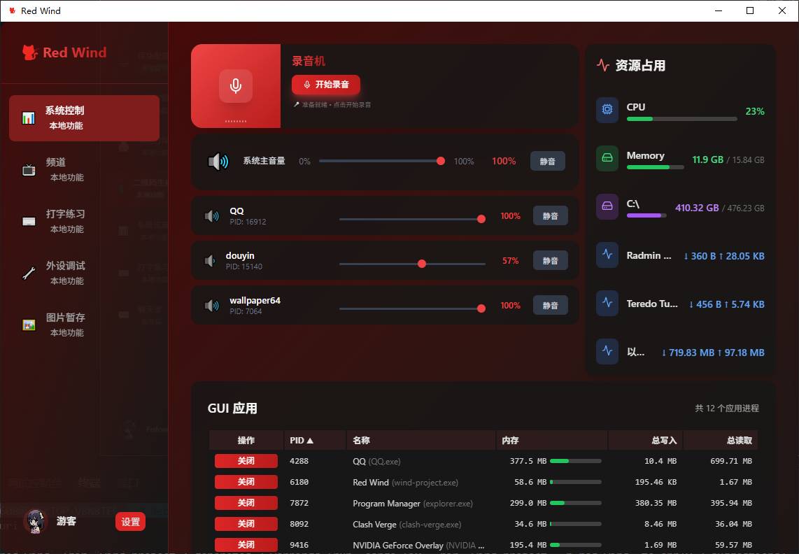
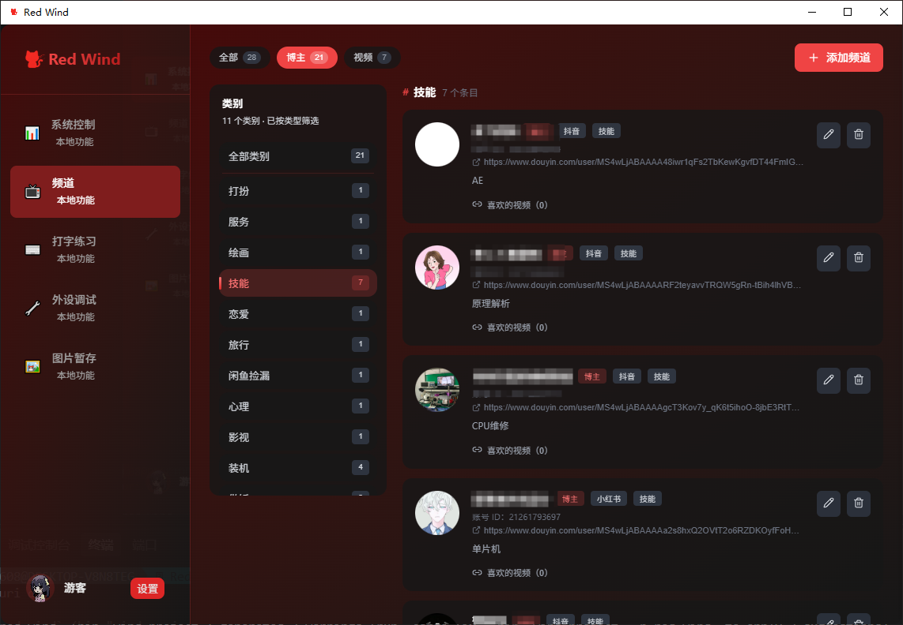
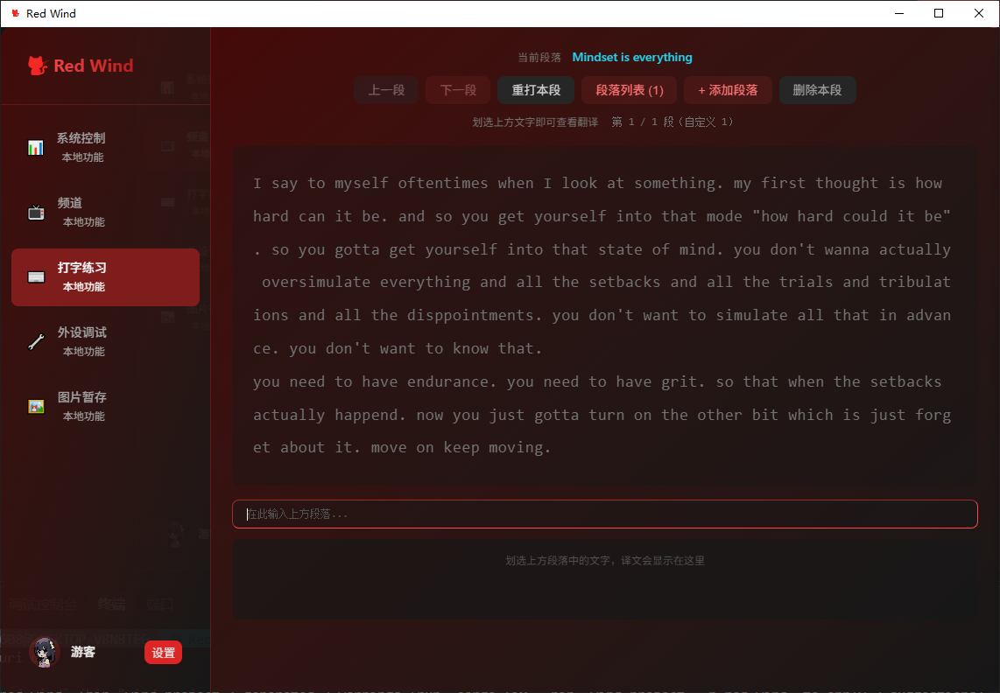
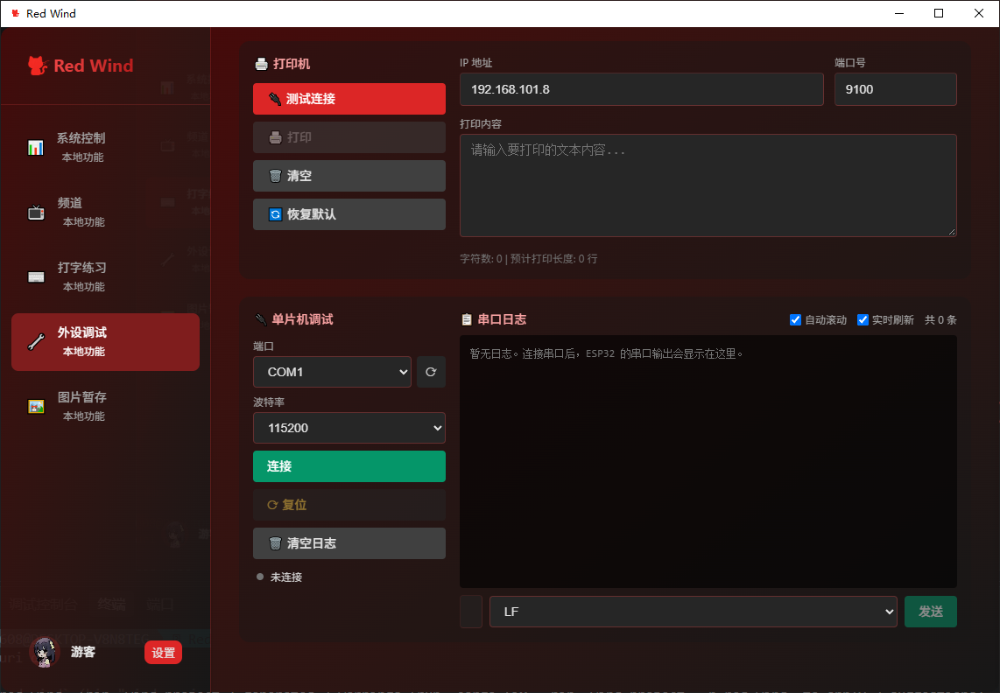
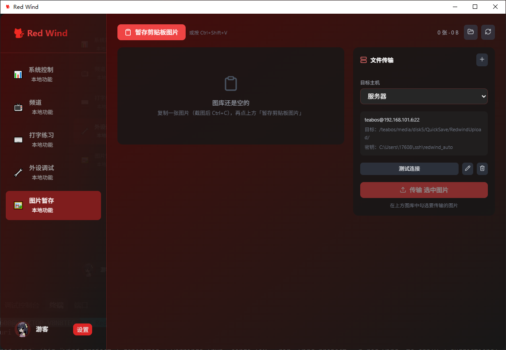
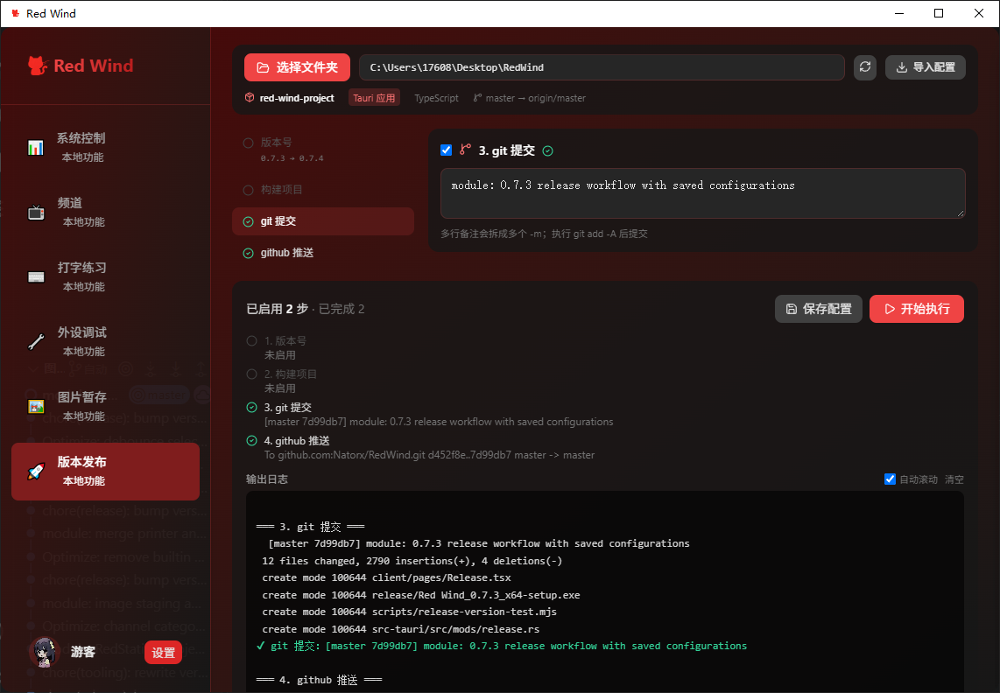

## Project Introduction

[简体中文](./README.zh-CN.md)

Red Wind Tool Library —— a lightweight multi-functional tool library for the desktop.

### Features
All features below are local; no server or external service is required.

| Module | Description |
| --- | --- |
| 📊 System Control | Hardware info and process management |
| 📺 Channel | Track the creators and videos you follow across platforms |
| ⌨️ Typing Practice | Type along with a passage, character-by-character highlighting, select text to translate |
| 🔧 Peripheral Debug | Printer (ESC/POS over TCP) and serial monitor (ESP32) on one page |
| 🖼️ Image Stage | Stash clipboard images with one click, then transfer them to a remote host over scp |
| 🚀 Release | Point at a project folder, then run version bump / build / artifact export / commit / push — each step optional |

Screenshots of retired modules are kept under `assets/history/`.

### System Architecture
- Frontend: React + Unocss + TypeScript.
- System: System API calls and program processes are handled by Rust (Tauri).
- Data: Local data is stored in SQLite, managed by the Rust backend.

> Earlier versions shipped an AI Agent (Python) and a Fastify server. Those modules
> are no longer part of the app, so Python and a running Node service are **not**
> required. Their source is kept in `agent/` and `server/` for reference only.

## For dev

### How to Start
You need Node.js (24.0.0+) and Rust. Features relying on newer Node APIs will not
work on older versions.

`pnpm install` to install the required dependencies.

`pnpm dc`: Run the client. Once it starts, the app is usable.

`pnpm updater`: Bump the version across `package.json`, `tauri.conf.json` and `Cargo.toml`.

`pnpm get_build`: Copy the built installer from `src-tauri/target/release/bundle/nsis` into `release/`.

### File Directory

redwind/
├── agent          Retired AI Agent service (Python), kept for reference; not part of the app.
├── assets         Images. `assets/doc` holds screenshots of the current modules, `assets/history` keeps those of retired ones.
├── client         Client side; all pages and components related to client-side rendering are in this folder.
├── commands       Some commands used to upgrade versions, quickly start the project, etc.
├── release        Installation packages for various versions of the software.
├── server         Retired Fastify (Node.js) service, kept for reference; not part of the app.
├── src-tauri      Backend built with Rust, used to launch processes and provide system integration functionalities as a backend for the client page.
└── wasm           Rust package kept from an earlier performance experiment; currently unused.
